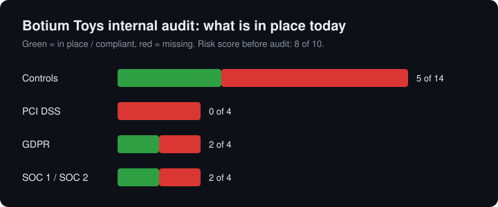

# Botium Toys Security Audit

An internal security audit of a fictional toy company, Botium Toys. I reviewed the IT manager's scope, goals and risk assessment, then checked which controls and compliance best practices (PCI DSS, GDPR, SOC 1/SOC 2) are in place. The audit ends with prioritized recommendations for the IT manager.

This is the portfolio project from the Google Cybersecurity Certificate (course 2, "Play It Safe: Manage Security Risks").

## The scenario

Botium Toys is a small U.S. business with one location that serves as office, storefront and warehouse. Online sales have grown, including customers in the E.U. The IT manager wants an internal audit to find out which risks and fines the company faces with its current security posture. The NIST Cybersecurity Framework is used as the baseline.

**Scope:** the entire security program. All assets, internal processes and procedures related to controls and compliance.

**Assets in scope:** on-premises equipment, employee devices, storefront and warehouse products, systems for accounting, telecom, database, security, ecommerce and inventory, internet access, internal network, data retention and storage, and legacy systems.

**Risk score before the audit:** 8 of 10.

## Results

### Controls assessment

| Control | Category | Type | In place |
|---|---|---|---|
| Least privilege | Administrative | Preventative | No |
| Disaster recovery plans | Administrative | Corrective | No |
| Password policies | Administrative | Preventative | No (exists, but too weak) |
| Separation of duties | Administrative | Preventative | No |
| Firewall | Technical | Preventative | Yes |
| Intrusion detection system (IDS) | Technical | Detective | No |
| Backups | Technical | Corrective | No |
| Antivirus software | Technical | Corrective | Yes |
| Monitoring and maintenance of legacy systems | Technical | Preventative | No (no schedule) |
| Encryption | Technical | Deterrent | No |
| Password management system | Technical | Preventative | No |
| Locks (office, storefront, warehouse) | Physical | Preventative | Yes |
| CCTV surveillance | Physical | Preventative/Detective | Yes |
| Fire detection and prevention | Physical | Detective/Preventative | Yes |

### Compliance checklist

| Standard | Best practice | Adheres |
|---|---|---|
| PCI DSS | Only authorized users can access credit card data | No |
| PCI DSS | Card data is stored, processed and transmitted in a secure environment | No |
| PCI DSS | Encryption for card transaction touchpoints and data | No |
| PCI DSS | Secure password management policies | No |
| GDPR | E.U. customer data is kept private and secure | No |
| GDPR | Plan to notify E.U. customers within 72 hours of a breach | Yes |
| GDPR | Data is classified and inventoried | No |
| GDPR | Privacy policies and procedures are enforced | Yes |
| SOC 1/2 | User access policies are established | No |
| SOC 1/2 | Sensitive data (PII/SPII) is kept confidential | No |
| SOC 1/2 | Data integrity (consistent, complete, accurate, validated) | Yes |
| SOC 1/2 | Data is available to authorized users | Yes |

## Key findings

- Every employee can reach internally stored data, including cardholder data and customer PII.
- Credit card data is stored and processed locally without encryption. This alone fails all four PCI DSS checks.
- There is no disaster recovery plan and no backups. A ransomware attack or disk failure could stop the business.
- There is no IDS, so nothing would show an attacker who is already inside the network.
- The password policy is weak and nothing enforces it.
- The company does not know exactly which assets it has, which makes it hard to judge the impact of losing one.
- Physical security is good: locks, CCTV and fire detection are all in place.

## Recommendations

1. **Protect cardholder data and PII.** Encrypt data at rest and in transit. Add least privilege, role-based access and separation of duties. Write a user access policy and review accounts every quarter.
2. **Make sure the business can recover.** Write a disaster recovery plan. Back up critical data, keep one copy offline or offsite and test restores twice a year.
3. **Add detection.** Install an IDS on the internal network.
4. **Fix passwords.** Raise the policy to current minimums, enforce it with a central password manager and add MFA for admin and remote accounts.
5. **Know the assets.** Build an asset inventory, classify data by sensitivity and set a fixed schedule for legacy system maintenance.
6. **Round off physical security.** Add locking cabinets for network gear, better lighting, alarm signage and a time-controlled safe.

Full reasoning is in the completed checklist.

## Files

| File | Content |
|---|---|
| [docs/controls-and-compliance-checklist.docx](docs/controls-and-compliance-checklist.docx) | Completed checklist with recommendations (Word) |
| [docs/controls-and-compliance-checklist.pdf](docs/controls-and-compliance-checklist.pdf) | Same document as PDF |

## How I did it

1. Read the scope, goals and risk assessment report, with focus on the asset list and the "Additional comments" section.
2. Mapped each comment to a control from the control categories document (administrative, technical, physical) and its type (preventative, detective, corrective, deterrent).
3. Marked each control and compliance best practice as yes or no based on what the report states.
4. Ranked the gaps by the risk they pose: fines and data loss first, then detection, then hardening.

## What I learned

- A control that exists on paper is not the same as a control that works. Botium Toys has a password policy, but it is too weak and nothing enforces it, so it counts as missing.
- One missing control can break several standards at once. Lack of encryption and least privilege fails PCI DSS, GDPR and SOC 2 together.
- Good physical security does not help much when the main risk is digital data that everyone inside can reach.
- Asset inventory comes first. Without knowing what you have, you cannot judge what a loss would cost, which is why NIST CSF starts with Identify.

## License

MIT. See [LICENSE](LICENSE). The Botium Toys scenario and checklist template come from the Google Cybersecurity Certificate.

Made by Talha Aker
